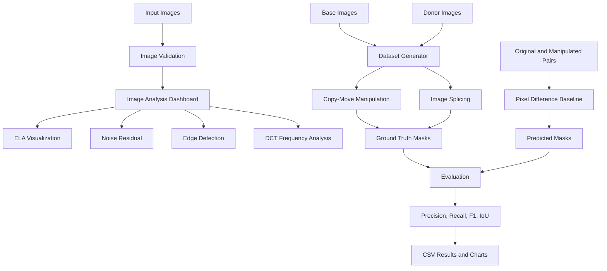

# ImageForensics — System Architecture

## Overall workflow

## Main modules

1. `app.py` — interactive Streamlit application.
2. `generate_dataset.py` — creates controlled manipulated image examples and masks.
3. `robustness_test.py` — evaluates image pairs under selected transformations.
4. `summarize_results.py` — calculates averages and creates research charts.

## Important distinction

The interactive visualizations are forensic analysis aids. The paired-image pixel-difference baseline requires an original reference image. This prototype is not a validated standalone detector for unknown forged images.
